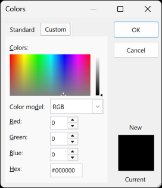
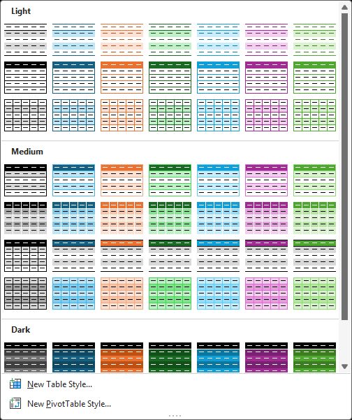
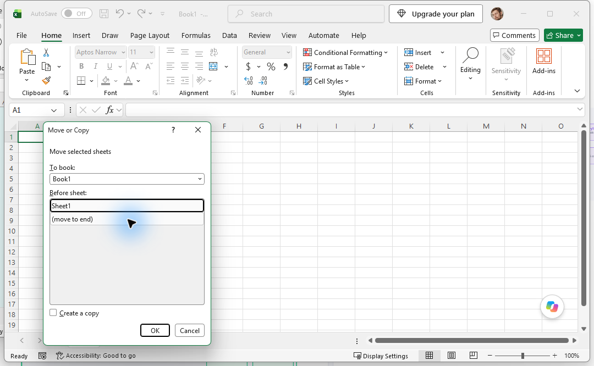

# Expanded Excel recording — 2026-10-18

## Purpose and method

Exercise the installed UI Atlas recorder with substantially more live Excel data, including contextual menus, nested popups, galleries and dialogs. The recording used the app's Manual mode with Hover enabled. Navigation was performed through the Computer Use plugin in a separate blank, unsaved `Book1`; the previously open Warehouse inventory workbook was not edited. Dialogs were canceled and no conditional-formatting rules, charts, sheet moves or protection were applied.

This is a new recording and map, rather than a replacement for the earlier Excel sample. It measures acquisition and presentation with the installed application; it is not a synthetic fixture or a claim of complete Excel coverage. Both workbooks remained open, which is relevant to investigating window-family scope.

- Recording ID: `20261018-094439-excel-c63a40af`.
- Recording: `C:/Users/danie/AppData/Local/UiAtlas/Core/recordings/20261018-094439-excel-c63a40af.mlrec`.
- Map destination: `C:/Users/danie/AppData/Local/UiAtlas/Core/maps/20261018-094439-excel-c63a40af.db`.
- Map authority: the adjacent `.db.uimaps` workspace; the `.db` is its compatibility projection.
- Capture interval: 09:45:51–10:02:23 UTC on 2026-10-18, approximately 16 minutes 32 seconds.
- Recording SHA-256: `bdb4717f1c9174955104a6d1c522202cb95b6d379b6933220cb4521d21708a7a`.

## Scale and acquisition health

| Metric | Earlier Excel recording | New recording |
| --- | ---: | ---: |
| Recorded frames | 3 | 38 |
| Raw native-HWND/UIA/MSAA source records | 12,615 | 71,173 |
| Independent HWND images | 4 | 70 |

The new sample has 12.7 times as many frames and 5.6 times as many source records. Source records include repeated controls across observations and providers; they are **not** a count of distinct controls or successfully understood features. The new bundle is 26.75 MiB.

The bundle outcome is `partial`. Of 38 frames, 9 have `ok` acquisition, 24 are `partial`, and 5 are `interrupted`. Stability is `stable` for 33 and `changed` for 5. The five changed captures have subsequent observations of the same UI; the first attempts remain preserved as evidence.

| Original provider | Successful attempts | Timeouts | Source records |
| --- | ---: | ---: | ---: |
| Screenshot | 38 | 0 | — |
| Native window topology | 38 | 0 | — |
| Native HWND | 70 | 0 | 887 |
| UIA | 43 | 27 | 11,544 |
| MSAA | 40 | 30 | 58,742 |

Provider success means the attempt returned, not that it covered all visible controls. An overall partial frame can still have a fully returned foreground-dialog attempt when a background window times out.

Machine-readable evidence: [recording summary](assets/2026-10-18-excel-expanded-map/recording-summary.json) and [per-window provider attempts](assets/2026-10-18-excel-expanded-map/provider-attempts.csv).

## What was visited

| Frames | Excel UI |
| --- | --- |
| 1 | Home ribbon baseline |
| 2–4 | Cell context menu, Filter and Sort submenus; Filter retry |
| 5–11 | Format Cells: Font, Number, Alignment, horizontal-alignment picker, Border and Fill; dialog moved into view |
| 12–13 | Nested Colors dialog: Standard and Custom tabs |
| 14 | Format Cells: Protection tab |
| 15–16 | Worksheet-tab context menu and Tab Color palette |
| 17–20 | Move or Copy and its workbook picker, including retries |
| 21 | Return from Move or Copy |
| 22–23 | Ribbon Font and Font Size dropdowns |
| 24–25 | Conditional Formatting and Highlight Cells Rules submenu |
| 26–28 | Greater Than dialog, retry with Editing tooltip, return |
| 29 | Format as Table gallery |
| 30–31 | Insert ribbon and Column chart gallery |
| 32–36 | Data ribbon, What-If Analysis, Goal Seek, return and Get Data tooltip |
| 37–38 | View ribbon and Freeze Panes menu |

Exact frame labels and statuses are in the linked JSON/CSV. A visited UI is not automatically a retained independent surface; the failures below matter.

## Verified acquisition findings

### Menus, galleries and nested Colors are present

- Sort, the worksheet context menu, Conditional Formatting, Highlight Cells Rules, the chart gallery, What-If Analysis and Freeze Panes have stable `ok` frames.
- Format as Table has an independent 504 × 601 image and 286 MSAA records. Its UIA attempt returns one root record. Frame 29 is partial because the main window's MSAA attempt times out.
- The Column chart gallery has 182 MSAA records and one UIA root record in frame 31.
- Freeze Panes has 122 MSAA records and one UIA root record in frame 38.
- Colors is a separate HWND `0x441224` with independent 272 × 315 pixels. Frame 12 has 18 UIA and 212 MSAA records; frame 13 has 33 UIA and 212 MSAA records. The background Format Cells window remains separate and disabled. These frames are partial because of other windows' provider failures, not because Colors is absent.

Exact source images, without annotations or reconstruction:





### Three visited dialogs are absent from the native window inventory

Move or Copy (frames 17–20), Greater Than (26–27), and Goal Seek (34) were opened during live navigation, but none appears as a scoped window or independent provider target in those recorded observations. Move or Copy is visibly present in the frame-18 composite screenshot. Goal Seek was partly outside the selected main-window screenshot bounds; its lower-right portion appears at the top-left of the frame-34 composite.

This is an acquisition boundary problem, preceding Raw World or Semantic World reconstruction. Repeated captures did not restore Move or Copy. The recorder's target topology and `WindowCatalog.ListScopedWindows` both filter by the selected root-owner family. That is a concrete investigation point; the sealed inventory has already discarded out-of-scope windows, so it does **not** prove the excluded dialogs' owner chains. A follow-up needs a diagnostic census before filtering to establish the exact cause without accidentally including unrelated workbooks or applications.



### Some retained windows have very little usable accessibility data

- Format Cells Font observations 5 and 6 and Fill observation 11 time out for both UIA and MSAA. The independent pixels survive, but they cannot supply genuine accessibility overlays.
- Format Cells Number observation 7 has 3,568 MSAA records and no UIA records. Its overlay therefore depends on MSAA and correct visibility/geometry handling.
- Font dropdown frame 22 has one UIA root record and an MSAA timeout. Capturing its pixels does not mean its menu items were mapped.
- Font Size frame 23 has one UIA root record and 148 MSAA records. Different Office popups expose materially different provider coverage.
- The live recording overlay visibly included displaced or oversized rectangles in parts of the dialog exploration. The derived editor views are checked separately below; a source-provider count cannot validate geometry.

## Build result: failed scale test

The recording passes the installed CLI's `recording validate` command. **The larger map did not build and cannot currently be opened in the editor.** Finalization started at 10:02:24 UTC; the failure was received by 10:10:52 UTC, approximately 8.5 minutes later. All 38 observation publications had been written by 10:10:15 UTC before final projection validation failed:

```text
error: finish-map.failed ... graph.count-limit:Graph exceeds node or edge limit.
Retained recording bundle: .../20261018-094439-excel-c63a40af.mlrec
Map build failed. The toolbar stayed open so you can try again.
```

The immediate cause is verified in [GraphValidator.cs](../src/UiAtlas.Core.Build/GraphValidator.cs): more than 100,000 nodes **or** more than 100,000 edges rejects the entire graph. [SqliteGraphStore.cs](../src/UiAtlas.Core.Storage/SqliteGraphStore.cs) separately caps full graph reads and layer reads at 100,000 rows, and graph files at 512 MiB. The failure message does not contain actual counts, so this run does not establish which count crossed the limit or by how much.

The projection combines Raw Data Streams, Raw World, Semantic World, state nodes, containment and lineage edges. Its total therefore differs from the 71,173 recorded source entries. This establishes an inconsistent practical capacity: the recorder accepts this recording, but the final map cannot retain its projected graph within the reader's limits. It does not establish whether all generated entities are necessary; growth needs measurement by layer before changing capacity.

During final projection, the recorder process had a sampled working set of 7,092,584,448 bytes, about 6.61 GiB. This is one sample, not a measured peak. Raising the validator limit alone would neither solve reader compatibility nor establish acceptable memory use.

The builder cleaned up its failed uncommitted generation. There is no new `.db` or committed `active.json` for this recording. The `.mlrec` and logical session metadata remain available; the earlier Excel map was not replaced. No Raw World or Semantic World visual pass on the new map is claimed. The images in this report are original recorded pixels, and the geometry findings below are original source records.

For a reproducible geometry example, [Colors frame 13 geometry](assets/2026-10-18-excel-expanded-map/colors-frame13-geometry.json) records a 272-pixel-wide window at 192 DPI. Its UIA Tab rectangle is 350 pixels wide, while the four native RichEdit rectangles have plausible positions inside the window. That confirms mixed source geometry; derived-view correction remains unverified because finalization failed.

## Follow-up priorities

1. Recover this complete recording through a coherent map-capacity fix: report actual node/edge counts by layer, measure avoidable duplication, align validator/storage/reader limits, and verify save/reopen under an explicit memory budget. Do not truncate frames or provider records to make the test pass. Add the retained 38-frame bundle as a local regression input.
2. Establish why the selected workbook's Move or Copy, Greater Than and Goal Seek dialogs are missing from acquisition scope. Retain diagnostic exclusion reasons and owner chains before making scope-policy changes.
3. Diagnose foreground provider timeouts, especially Format Cells and Font dropdown. Make foreground coverage distinguishable from aggregate/background health in the recorder status.
4. Validate high-DPI geometry and visible-item coverage for both UIA and MSAA on Colors, Format Cells and Office galleries. Preserve original raw records and keep corrections confined to derived views.
5. Expose actual frame/stage progress during finalization and report capacity failures with counts and actionable recovery information. This recording spent about eight minutes processing before the size rejection surfaced.

No acquisition or presentation code was changed for this exercise. This preserves the new recording as a baseline for reproducing and measuring the remaining defects.

## Assessment

The larger live sample adds useful contextual-menu, gallery and nested-dialog evidence. It also demonstrates that the current system is not yet reliable for a broader Excel map: three visited dialogs were omitted from acquisition, provider failures leave some windows without usable controls, mixed-DPI geometry persists in the source data, and the map build exceeds the application's own graph capacity. The recording succeeded as a retained diagnostic dataset; the end-to-end map result failed.
