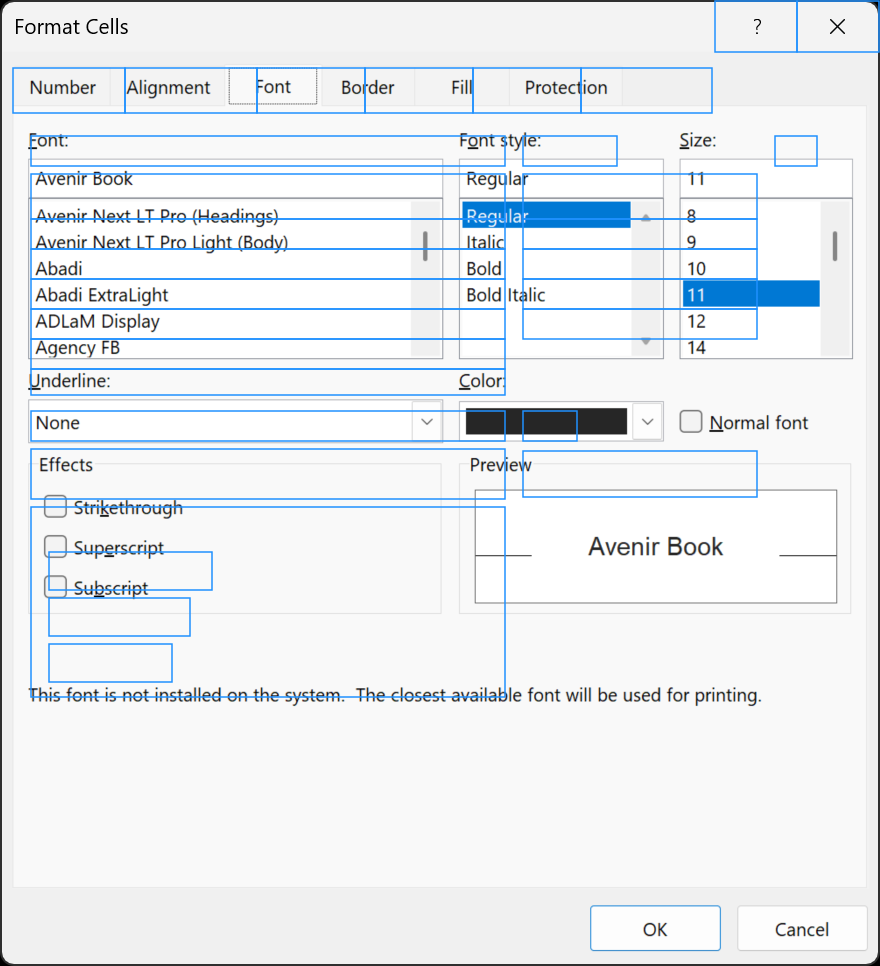
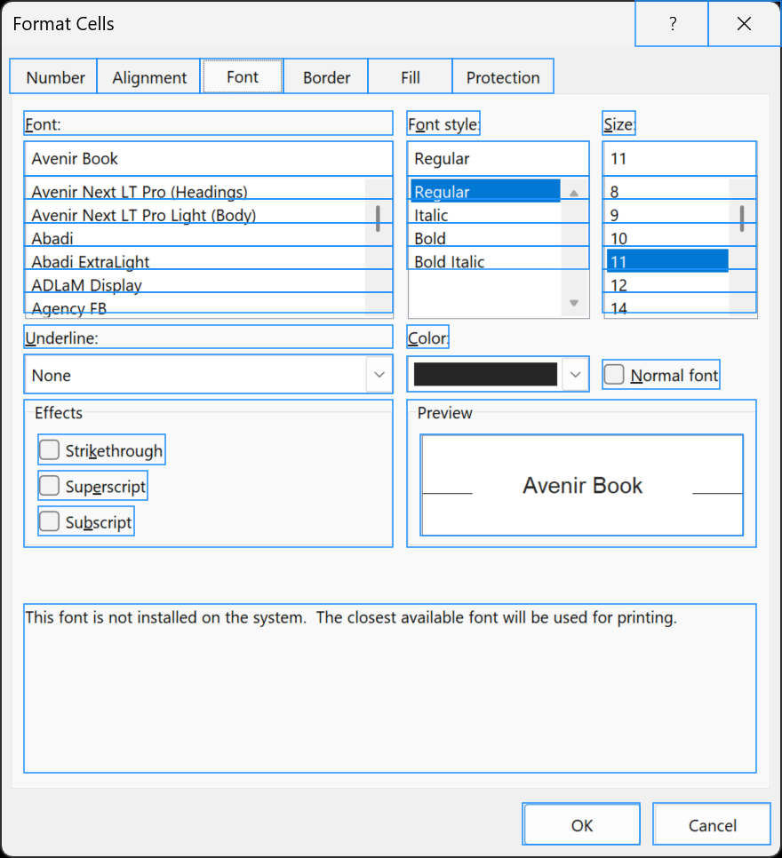
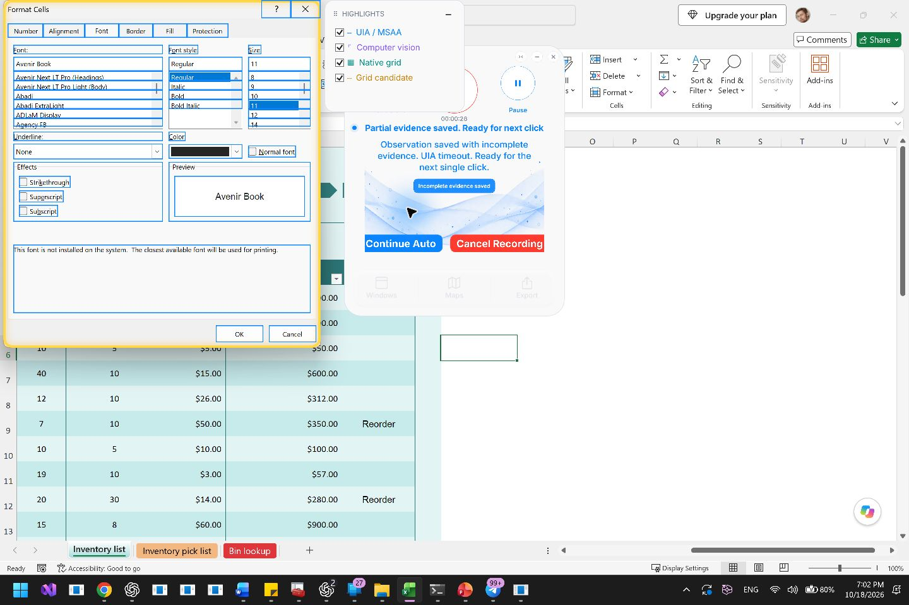

# Excel Format Cells: fractional-DPI overlay correction

## Report and evidence

The user's screenshot shows blue control rectangles that extend beyond the real
Font, Font style, and Size fields, and checkboxes shifted below their controls.
The native title-bar buttons remain aligned. OK and Cancel have no overlay.

The matching evidence is frame 2 of
`20261018-105733-excel-cc06cdb2.mlrec`, retained in the local recording catalog.
The capture reports the Excel main window at 168 DPI (175%), while the Office
SDM Format Cells window reports 192 DPI (200%). Its native client rectangle is
`(11, 51, 876, 913)`. The MSAA client root agrees with that physical rectangle,
but its virtual descendants use a different scale.

| Control | Raw provider rectangle `(x,y,w,h)` | Corrected presentation rectangle |
| --- | --- | --- |
| Font edit | `(41,174,474,45)` | `(37,159,415,39)` |
| OK | `(682,1026,151,54)` | `(598,904,132,47)` |
| Cancel | `(850,1026,151,54)` | `(745,904,132,47)` |

The independently captured native `EDTBX` windows are
`(45,164,401,29)`, `(475,164,191,29)`, and `(696,164,159,29)`.
Scaling the virtual descendants by `168 / 192 = 0.875` about the physical client
origin makes all three virtual edit fields enclose their native edit fields
with no more than eight pixels of inset at each edge. The same transform puts
OK and Cancel on their visible buttons. Scaling the entire dialog would instead
damage its already-correct native chrome.

## Root cause

This is a mixed-coordinate-space defect in Office SDM accessibility evidence
combined with insufficient qualification in Atlas's live presentation path.
The existing correction covered MSAA using client dimensions queried in two
Windows DPI contexts. It had no independent native-control check for fractional
monitor scales, required the recorded DWM rectangle even for passive observations
using outer-window bounds, and did not handle virtual UIA descendants.

In addition, the passive exact-window UIA refresh bypassed the projection
entirely. A fresh refresh could therefore replace previously corrected
presentation bounds with raw provider bounds.

The retained recording proves the geometry mismatch and the matching 0.875
transform. It does not retain the two historical `GetClientRect` call results;
the exact Win32 branch taken by the old executable at 175% is not established.

## Implemented repair

- `MapperMsaaGeometry.ProjectLive` obtains a candidate ratio from the current
  monitor scale and reported dialog DPI. Windows exposes the monitor scale via
  [GetScaleFactorForMonitor](https://learn.microsoft.com/en-us/windows/win32/api/shellscalingapi/nf-shellscalingapi-getscalefactorformonitor).
- The ratio alone never authorizes scaling. At least two visible virtual edit
  fields must each match a unique, same-process native edit rectangle after
  transformation. Ambiguous matches, already-aligned fields, and insufficient
  evidence leave the provider's rectangles unchanged.
- MSAA and UIA qualify independently. Only virtual client descendants are
  projected; native HWND subtrees, title bars, unrelated windows, and visual
  evidence retain their coordinates.
- The live target guard accepts the appropriate DWM or outer-window convention.
  The existing measured-client MSAA fallback remains available.
- Passive exact-window refresh now calls the same projection before building
  highlights. Existing revision and target-bound checks remain in place.
- Provider packets and recording files retain their original coordinates. This
  is a live overlay correction; it does not rewrite historical source evidence
  or change grid extraction and classification.

## Verification

### Retained failing frame

The frame was replayed through the updated geometry projection and the actual
`MapperHighlightModel.Build` logic, then drawn over its captured per-window
image. These two images are **rendering replays**, not new live captures:

| Before | After |
| --- | --- |
|  |  |

Visible highlight count changes from 31 to 44. OK and Cancel are included again;
the Font controls and checkboxes align with their pixels. Projection changes
2,308 source-derived presentation records, including offscreen records; this
count is not the number of visible controls. The numeric receipt is
[replay.json](assets/2026-10-18-overlay-fractional-dpi/replay.json).

### Tests and build

The focused suite passed **41 tests, zero failures**: nine new geometry cases
plus existing highlight, Office MSAA, stationary-overlay, and owned-dialog
regressions. Coverage includes 175% geometry for both provider types, independent
provider qualification, immutable source records, unchanged native children,
idempotence, wrong-window input, insufficient or ambiguous anchors, already
physical geometry, and invalid scales.

```powershell
dotnet test tests/UiAtlas.Core.Tests/UiAtlas.Core.Tests.csproj --filter 'FullyQualifiedName~MapperOfficeGeometryTests|FullyQualifiedName~MapperHighlightTests|FullyQualifiedName~OfficeMsaaGeometryTests|FullyQualifiedName~MapperOverlayWindowTests.StationaryOverlay|FullyQualifiedName~MapperOverlayWindowTests.OwnedDialog'
dotnet build src/UiAtlas.Core.Cli/UiAtlas.Core.Cli.csproj
```

Tests used an isolated output directory. The subsequent normal build succeeded
with zero warnings and zero errors and installed **recorder build 198** into the
local Debug output.

### Fresh live check

Build 198 recorded the open Font tab into
`20261018-150046-excel-6389ddd9.mlrec`. The live blue rectangles align with the
edit fields, list items, checkboxes, preview, and OK/Cancel buttons. This fresh
session reports 192 DPI for both Excel and its dialog, so it verifies the
current live path without double scaling; the failing 175% case is verified by
the retained-frame replay and regressions above.



The one-frame verification recording finalized, passed `recording validate`,
and built a map successfully (19,816 nodes, 26,631 edges). It remains marked **Needs review / partial** because
the UIA attempt timed out; MSAA evidence supplied the displayed dialog controls.
That timeout is an acquisition limitation and is not repaired by this geometry
change. No cell formatting was applied during verification.

## Scope

This closes the reported live rectangle-placement defect with conservative
Office-specific qualification. It does not claim to resolve UIA timeouts,
every provider's geometry defect, historical viewer presentation, or the
unrelated large-map graph limit. Earlier origin-stability work is described in
[the live overlay coordinate RCA](2026-10-18-live-overlay-coordinate-rca.md).
