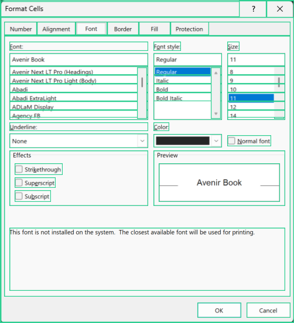
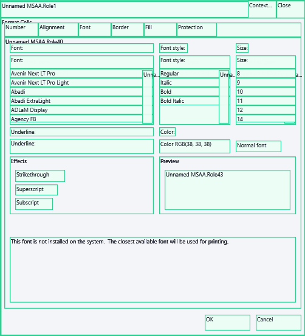

# Semantic World: test5 comparison and implementation rollout

Date: 2026-10-18. Scope: UI Atlas mapping and Knowledge Graph Editor.

## Reference contract and actual test5 behavior

Sources inspected in `C:/stuff/dev/successors/test5`:

- `docs/archive/docs/Definite Rules for UI Knowledge Graph Formation.md`, especially Semantic World, control identity, and selection contracts.
- `docs/archive/docs/uikg-iteration-2-canonical-layered-truth-pr-rollout.md`, especially semantic persistence, popup families, typed lineage, and visual/data parity.
- `docs/archive/docs/uikg-semantic-world-properties-pane-pr-rollout.md`.
- `UiMappingApp2/UiKnowledgeGraph/UiKgAppMapReadModel.cs`: `BuildObservableSemanticLayerFromObservableRaw`, `BuildObservableSemanticSurface`, and `BuildObservableSemanticControl`.

The plan distinguishes four responsibilities: original observations (RDS), reconstructed objects (Raw World), app-level meaning (Semantic World), and durable authored/canonical knowledge (Atlas). Semantic World interprets Raw World. It must not recollect or combine provider packets in the editor.

Semantic ordinary windows, authored main windows, dialogs, and popup concepts have separate identities and scoped controls. A popup family is anchored by application, native class, and semantic opener/anchor; a content variant distinguishes the menu actually observed. HWNDs, runtime IDs, and random suffixes are evidence, not semantic meaning. An unknown opener stays unknown. Same label on two surfaces does not establish shared control identity.

The editor preserves the selected object and concrete observation, inherits Raw World geometry and screenshots, exposes upstream evidence, and distinguishes reproducible, inferred, ambiguous, and diagnostic-only interpretations. Review/publication or runtime readiness is a separate fact. Properties explain meaning, source surfaces, visual/data evidence, and lineage. A singleton surface does not need a redundant Variant tab.

The reference implementation is not identical to every historical plan: its current read model derives semantic surfaces directly from Raw World and suppresses observed-variant lists for popup surfaces. The rollout documents are requirements and design intent, not proof that every historical persistence or runtime gate shipped. This implementation uses the reference selection and evidence contract while retaining explicit observed popup variants.

## Current Atlas gaps confirmed in source

1. `AtlasMapProjection` assigns `semanticSurfaceKind=Window` to every Map surface, losing dialog/popup distinctions.
2. It omits `MapSurfaceVariant` entities. The editor manufactures a flat frame carousel, without the persisted variant ID, name, or structure signature.
3. Semantic evidence uses the original draft's `BoundsPx`, even when Raw World has subsequently corrected those coordinates. Historical review data is valid authority for names/assignments, but is not the current reconstructed geometry.
4. Per-observation Raw World visibility, occlusion, and source identity are not propagated to semantic presentation. Offscreen controls from inactive dialog tabs can be painted on the selected tab.
5. Semantic screenshots use the generic composite/inherited image path. The selected dialog should use its own HWND and same-frame image, just like Raw World.
6. The reader looks up only the first `sourceRawSurfaceId` and uses repeated linear scans for parent membership. Multiple source surfaces and large dialog trees amplify correctness and loading problems.
7. Generic properties mix observations, review state, and arbitrary graph fields. They do not clearly explain semantic interpretation, typed lineage, concrete variants, evidence quality, or ownership conflicts.
8. The native Map already contains durable entity IDs, review commands, grid schemas, and structure variants. Replacing it with the legacy graph builder would discard current authority and regress data-grid work.
9. The carousel's `VariantsFor` aggregation rebuilt variant objects and discarded HWND/semantic identity, even for a single surface. Direct renderer tests bypassed this path. The repair retains exact modern variant objects and tests real editor selection.

## Goals

- Typed semantic windows/dialogs/popups; retain authored Map identity and names.
- Persist the actual Map variants in the compatibility graph and expose variant identity separately from frame identity.
- Same-observation Raw World geometry, visibility, source HWND, and isolated image for all five AppMap modes.
- Keep inactive/offscreen controls inspectable without painting them as current visible controls.
- Explicit source lineage, interpretation/evidence status, review state, and unresolved ownership.
- Preserve reviewed grids/columns, recording bytes, draft etags, reviews, and publication history.
- Reopen existing workspaces with these fixes without requiring a new recording.

## Non-goals

- No new sensor collection, provider fusion, fabricated UIA, or changes to RDS.
- No automatic acceptance/publication, action authority, private runtime migration, or importing test5 product code.
- No guessed popup opener or automatic destructive rewriting of existing reviewed assignments.
- No claim of universal application coverage or full runtime parity from an editor fix.

## PR rollout / acceptance checklist

### PR 1 — semantic projection contract

- [x] Derive semantic surface class from all linked Raw World sources; flag conflicting classes.
- [x] Retain real Map variant refs, names, review state, and structure signatures as semantic states.
- [x] Retain typed interpretation lineage and Map authority references.
- [x] Project current Raw World bounds while retaining historical Map evidence in the authoritative workspace.
- [x] Keep reviewed grid columns as schema evidence, not invented control rectangles.

### PR 2 — exact observation presentation

- [x] Resolve every source surface and per-frame HWND; do not use the first source as a representative.
- [x] Project control scene facts from the matching upstream observation; preserve semantic names/roles.
- [x] Draw only valid visible regions; keep ambiguous source/ownership evidence diagnostic.
- [x] Use independent same-frame window images in Window, Controls, Overlay, Structure, and Structure Overlay.
- [x] Preserve concrete semantic variant identity during selection and suppress redundant variant UI for singletons.

### PR 3 — explanation and navigation

- [x] Semantic-specific properties: meaning/type, source surfaces, materialization, visual/data evidence, review state, lineage, variant identity/signature, and diagnostics.
- [x] Reach exact upstream Raw World evidence from the selected semantic surface/control.
- [x] Keep review and grid tools working; avoid eager construction of thousands of invisible tree entries.

### PR 4 — verification and local rollout

- [x] Regression fixtures: dialog versus normal/popup, multiple observations/HWNDs, corrected bounds, offscreen controls, rejected entities, ambiguous ownership, variant persistence, reviewed names and grids.
- [x] Relevant reader, mapping, renderer, graph-integrity and workspace round-trip tests pass.
- [x] Inspect the retained Excel Format Cells recording in all five modes and verify no worksheet pixels or inactive-tab overlays appear.
- [x] Build/install the normal CLI/viewer, reopen the managed map, validate it, and leave a useful Semantic World view open.
- [x] Record measured results and remaining limitations below.

## Results

Implemented and locally deployed on 2026-10-18. These are implementation slices, not remote pull requests.

### Shipped behavior

- The native Map remains authoritative for semantic IDs, reviewed names, assignments, variants, grids, and publication history. The compatibility graph now projects real semantic variants and typed `semantic-interpreted-from` links; integrity validation checks those links.
- `SemanticMapProjection` derives dialog/popup/window meaning and exposes source conflicts. `SemanticWorldPresentation` binds each control to its exact upstream observation. Corrected bounds and visible regions come from Raw World; reviewed semantic names remain intact.
- The reader and actual editor carousel retain frame, bundle, HWND, and semantic variant identity. Semantic AppMap uses the independent HWND image in all five modes. The properties pane explains interpretation, authority, evidence, variant signature, and unresolved cases, with a link to the exact Raw World observation.
- Rejected entities/variants do not reappear through projection. Reviewed grid columns remain schema evidence instead of borrowing a host rectangle. Large control trees load children on expansion; all retained controls remain inspectable.

### Verification

| Check | Result |
| --- | --- |
| Related core regression suite | 192 passed, 0 failed |
| Mapping suite excluding native `LiveMappingTests` | 53 passed, 0 failed |
| Normal CLI/viewer build | 0 warnings, 0 errors |
| Shared foundation boundary check | 69 pinned files; no external implementation dependency |
| Retained Excel map rebuild and integrity validation | 27,321 nodes; 34,863 edges; passed |
| Original retained recording | SHA-256 unchanged |
| Map draft authority during projection | Draft etags unchanged |
| Installed editor | Reopened managed Excel map; Semantic World / Format Cells selected; exact HWND and independent image confirmed |

Regression coverage includes semantic types, real variants, lineage validation, safe export, rejected variants, reviewed labels, schema-only grid columns, corrected geometry, offscreen records, conflicting ownership, multiple source HWNDs, and selection through the real editor methods. The renderer regression exercises Window, Controls, Overlay, Structure, and Structure Overlay for isolated and masked dialog evidence.

The retained Excel recording was `20261018-072025-excel-c3e5072b.mlrec`. Format Cells frame 3 resolves to HWND `0x5F90DBC`, with a 502 × 552 independent image. It retains 3,576 source-backed semantic controls, of which 106 visible regions are drawn. Controls/Overlay produce 92 image crops; Structure modes draw the same 106 regions without crops; Window mode draws no rectangles. The isolated dialog viewport contains no worksheet pixels, and controls from inactive tabs remain outside the visible projection.

Actual WPF AppMap render, using the same selection path as the installed editor:

The persisted semantic variant is `uimaps:surface-variant:f5d535cef4914d95a43073bfe51c2f63`. A separate read-only check of retained Word map `20261015-103851-winword-1a1fd5a8.db` found the expected semantic popup, normal window, and Font dialog, with 4, 9, and 1 concrete semantic variants respectively. This was retained-map verification, not a new live recording.

Reproducibility evidence on this machine:

- Test receipts: `C:/Users/danie/.codex/tmp/uiatlas-semantic-20261018/results/semantic-regressions.trx` and `semantic-mapping.trx`.
- WPF probe and five mode images: `C:/Users/danie/.codex/tmp/uiatlas-semantic-20261018/probe/`.
- Recording SHA-256: `1b5f95c6f28998bb9d291caa1b26157708aa2762122fad192b2e996b38906e6b`.
- Rebuilt graph semantic hash: `11372c7c8c1167dcbefb0c20089d4a4e9f9c977f24dd093c582b8158ab18a04b`.

### Remaining boundaries

1. The retained Excel observation reports UIA timeout with zero records and MSAA success with 3,570 records. These fixes display the supplied evidence correctly; they do not recreate missing UIA data or solve that historical provider timeout.
2. The inspected Word Map does not supply an observed popup opener/anchor. Popup identity therefore uses the existing Map surface reference and explicitly reports the anchor as unresolved. Full canonical popup-family identity across independently recorded maps requires a real opener relationship and a subsequent reviewed Map assignment. A title, HWND, or geometric overlap is insufficient evidence.
3. This completes the documented Semantic World projection, observation, and editor repairs. It does not claim that every historical test5 Atlas publication/runtime plan is now implemented. Existing Map review/publication authority is preserved, and no entity was automatically accepted or published.
4. Native live-interaction tests and a new recording were not run for this change. Verification used regression fixtures, the real WPF selection/rendering path, retained Excel/Word maps, and the installed editor.
