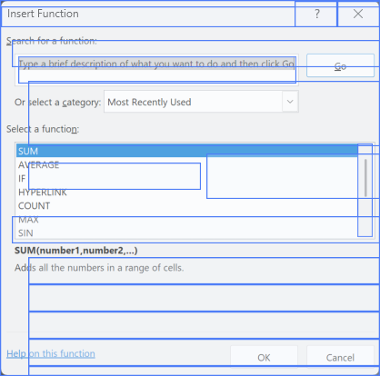
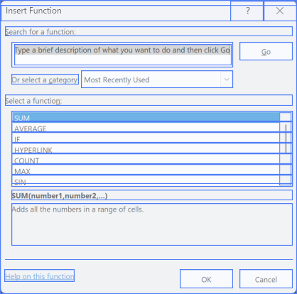

# Insert Function: Raw Data Streams coordinate registration

## Evidence and root cause

The reported observation is frame 16 of `20261018-172907-excel-dbb8ea28`,
Insert Function, HWND `0x2AE127E`, class `bosa_sdm_XL9`.
UIA succeeded with 31 records; MSAA succeeded with 104 records. Neither source
is missing. Native HWND capture added two independent rectangles.

Excel's recorded display DPI is 96; the dialog reports 192. Its visible image
bounds are `(2921,381,418,414)` and its physical client is `(2922,410,417,384)`.
UIA and MSAA both report virtual client controls at twice the physical scale.
For example, UIA reports OK at `(3425,1110,151,54)`, outside the dialog.
The native edit and scrollbar, and the title-bar controls, are already physical.
This explains why only part of the overlay is wrong.

The raw renderer clipped the original oversized rectangles to the dialog and
disabled affected pixel crops. This prevented background-window leakage, but
left misleading overlapping rectangles. The prior live-highlight repair did
not run in this saved-map renderer. Its multiple-edit qualification also cannot
qualify Insert Function, which contains only one native edit field.

## Fix outline

1. Register provider coordinates to the recorded image only when same-frame,
   same-window evidence supports the DPI transform. Qualify each provider
   attempt independently. Require multiple native anchors: multiple edit fields,
   or an edit field plus a list's native vertical scrollbar.
2. Transform only virtual client descendants. Preserve native HWND descendants,
   physical chrome, provider identity, record counts, ancestry, and every stored
   rectangle. Do not use live Windows state to reinterpret a historical frame.
3. Use registered display bounds consistently in Controls, Overlay, Structure,
   and Structure Overlay. Keep Window pixels and the bounded dialog canvas.
4. Explain registration in the canvas, show original and display bounds in
   tooltips, and provide a Reported coordinates option for literal inspection.
   Unqualified records retain the existing warning and crop protection.
5. Add geometry and actual-renderer regressions, replay the user's retained
   frame, verify source hashes, rebuild, and reopen the existing map.

This is image-coordinate registration, not scene reconstruction: it adds no
controls, fuses no provider responses, changes no ownership, borrows no frames,
and writes no corrected coordinates into raw records. It supersedes the earlier
raw-view default of always drawing reported coordinates; those coordinates
remain explicitly available. Grid extraction and map review are outside scope.

## Verification

Implemented in `RawOfficeCoordinates` and the AppMap renderer. Native maps
expose the provider's runtime-ID array as a property; registration uses the
sealed observation's evidence identity instead, so reopening existing maps
finds the same original records. Cropping protection is scoped to each attempt.

**61 tests passed**, including 12 new cases. These cover independently qualified
UIA/MSAA attempts, the edit-plus-scrollbar case, already-physical coordinates,
native children/chrome, ambiguous or absent anchors, wrong window/class/DPI,
hidden anchors, unknown scope, immutable source records, and the actual WPF
renderer across all five modes and repeated source/coordinate toggles. The
renderer regression also uses native-map-style runtime-ID properties.

Replayed the existing map workspace (94,404 graph nodes), not a replacement
recording. All 16 UIA/MSAA rendering combinations passed geometry checks:

| Source | Original visible rectangles | Registered visible rectangles | Pixel crops in Controls/Overlay |
| --- | ---: | ---: | ---: |
| UIA | 17 | 26 | 21 |
| MSAA | 28 | 46 | 39 |

Every canvas remains **418 x 414**. OK returns to local `(253,379,75,27)`.
MSAA's duplicate source records remain separate; its two OK rectangles are not
invented or fused. Both sources retain all their original records, including
offscreen and invalid geometry in Frame streams.

| Original UIA Structure Overlay | Registered UIA Structure Overlay |
| --- | --- |
|  |  |

These are images rendered by the actual AppMap component from the retained
frame. The full numerical receipt is [replay.json](assets/2026-10-19-insert-function-coordinates/replay.json).
The normal development build succeeded with zero warnings and zero errors,
producing **build 204**. The existing map was reopened with that build.
The running editor was checked on Raw Data Streams / Dialog Window / frame 16 /
Structure Overlay, first with UIA and then with UIA + MSAA. Both align with the
recorded dialog; the editor is left on the corrected UIA view.
[Live build 204 screenshot](assets/2026-10-19-insert-function-coordinates/live-build-204.png).

Reverified in **build 208**, after the PowerPoint hashing repair. The deployed
Reader DLL matches the built DLL. Reopened the original Excel map and checked
frame 16 in Structure Overlay with UIA alone and UIA plus MSAA: Go, the function
list, OK, and Cancel align with the saved image. The banner reports 20 qualified
UIA records, or 90 with both sources selected; offscreen records are still
retained and filtered according to the existing display setting. All 31 UIA
and 104 MSAA source records remain available. The editor is left on both sources.
[UIA in build 208](assets/2026-10-19-insert-function-coordinates/live-build-208-uia.png)
and [both sources in build 208](assets/2026-10-19-insert-function-coordinates/live-build-208-both.png).

The original `.mlrec` SHA-256 is unchanged before/after:
`f873326e65bf64e5f5773727feab5d2215c3de782423c3e846bcf23206676ae1`.
No graph rebuild, review edit, recording rewrite, or Excel interaction was
required. This fix does not change acquisition timeouts or world reconstruction.

Reproduction commands:

```powershell
dotnet test tests/UiAtlas.Core.Tests/UiAtlas.Core.Tests.csproj --filter 'FullyQualifiedName~RawOfficeCoordinatesTests|FullyQualifiedName~RawPopupRepairTests|FullyQualifiedName~RawMenuPresentationTests|FullyQualifiedName~RawObservationEligibilityTests|FullyQualifiedName~RawWindowEvidenceTests'
dotnet build src/UiAtlas.Core.Cli/UiAtlas.Core.Cli.csproj
```

Tests used an isolated build root to keep the original editor running until
the final normal build. When no unique same-observation transform can be
established, the viewer retains reported bounds and the coordinate warning.
