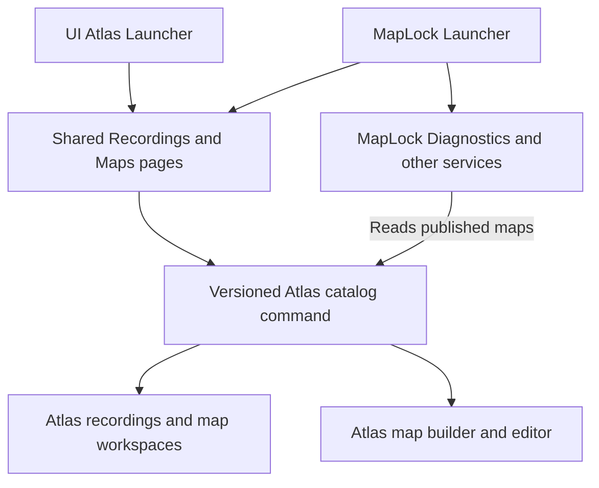

# One Atlas library in both launchers

UI Atlas owns UI Map recordings, construction, review, publication and storage.
MapLock hosts that same experience alongside its other features. This supersedes
the separate MapLock library and snapshot-import design in the first launcher iteration.

## User experience

Both launchers provide Maps and Recordings. Recordings supports starting capture,
building a UI Map, cancelling a build, opening the Atlas editor, and importing
retained evidence. Maps supports the existing application grouping, draft/review
status, archive/restore, and Ready designation. Publication still requires Atlas
validation and review. Changing a library entry affects the shared workspace.

Pages refresh when loaded, after an operation, and when the launcher regains focus.
Refresh remains available explicitly. Settings and Recordings show the catalog
location. The recorder HUD, editor and both launchers honor `UI-ATLAS_DATA_HOME`;
the default remains `%LOCALAPPDATA%\UiAtlas\Core`. Recording profiles and map-build limits use the same Atlas settings in
both products; the older MapLock capture controls are identified as Diagnostics
settings. The old MapLock permanent archive-purge control was removed.

Both solutions retain Launcher as the default startup project. UI Atlas retains
its Maps default and configurable Diagnostics start page. MapLock retains its Home
and startup preferences; `MapLock.exe --workspace recordings` or `--workspace maps`
provides a direct route. The `ui-atlas` help, interactive `shell`, desktop `app`,
recording, editor and other CLI commands retain their behavior.

## Ownership and deployment

`UiAtlas.Catalog.Contracts` defines a versioned JSON request/reply contract without
MapLock or Protobuf dependencies. Shared shell components own the Recordings page,
catalog client and Maps adapter. The `ui-atlas catalog` process owns all catalog
I/O and map mutations. MapLock's Protocol types are populated from serialized
Atlas results; its private services do not load Atlas's competing dependency set.

The common default is `%LOCALAPPDATA%\UiAtlas\Core`. `UI-ATLAS_DATA_HOME` overrides
it for either launcher. Every launched Atlas command inherits the resolved root.
Separate overrides intentionally select different libraries; this is local shared
storage for the same Windows user, not cross-machine synchronization.

Atlas's `.db.uimaps` workspace remains authoritative and `.db` remains the editor
projection. Workspace leases serialize writers; stale generations are rejected.
Cancellation is sent cooperatively to the Atlas worker so a build can unwind.

MapLock stages its matching Atlas CLI, native recorder and editor under `atlas/`.
Standalone Atlas stages those tools under `tools/`. The desktop MapLock Launcher
no longer stages or starts a Map host. Diagnostics reads Ready revisions from
Atlas and passes them to localization; its former UI Map authoring entry points
open the shared library. Other MapLock services remain available.

## Previous data

No existing catalog is deleted or silently converted. Existing Atlas recordings
and maps appear immediately. Previous MapLock-only maps remain in their original
storage and are excluded from the active library.

**Find previous MapLock recordings** inventories retained `.mlrec` and `.atlasmap`
files under the former handoff storage and retained workspace archives. Import
copies the selected artifact into Atlas, retains source files, validates bundles,
and detects identical imports. Conflicting recording identities are rejected.
Workspace imports retain review state and register their source recordings, so
the imported map can be rebuilt and opened through either launcher. Arbitrary
old MapLock database files are not relabeled as Atlas workspaces.

## Verification

Automated coverage includes real process communication across the MapLock/Atlas
dependency boundary, shared recording discovery, build, archive/restore, import
deduplication and workspace round-trip, stale generation rejection, cancellation,
writer-lock contention, and the existing shell/CLI/settings regressions.

Both root solutions built in Release with zero warnings or errors, and both
launchers published successfully. Focused automated suites passed: 75 MapLock
application tests, 31 Atlas core/catalog/settings/CLI tests, 60 mapping tests,
3 shell tests and 13 Diagnostics tests (182 total, none skipped).

The existing user catalog contained 23 recordings, which MapLock's Recordings
page displayed. Interactive mutation checks used an isolated catalog:

- MapLock built a two-frame synthetic recording into 38 nodes and 52 edges.
- The already-open Atlas launcher showed that map after regaining focus.
- MapLock's Open map action launched the Atlas editor with that workspace.
- A fresh attended recording of the Live Grid test app, started in Atlas, saved
  two frames and built an Atlas map. MapLock discovered both without an import.
  The brief recording was labeled partial when stopped during capture.
- The former Diagnostics map-library entry point opened the shared Maps launcher
  and exited successfully without starting a Map host.
- The recorder's Saved Maps panel was checked after fixing catalog-path handling;
  it displayed only the two maps in the configured test catalog.

Full release ZIP certification remains separate from build/publish verification;
the pre-existing asset and foundation-provenance failures documented in the
launcher notes are not bypassed.

The later [Visual Studio Debug staging fix](2026-10-19-maplock-debug-launcher-build-rca.md)
addresses CS0006 for the isolated catalog reference assembly. The original
command-line Release checks did not cover Visual Studio's dependency-build flags.
